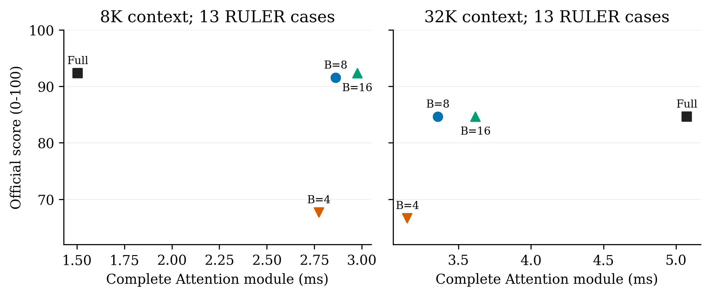

# Bucket-selection budget: paired quality and latency

This Qwen3-8B pilot holds the SAE dictionary (3,000 features), key assignment,
original-K moments, prefill and indexed attention fixed. It varies the number
of ranked buckets retained before bitmap union: B=4, 8 or 16. All 36 layers
and 288 KV groups are sparse. Full Flash is the dense control.

The 26 inputs are the same shared development cases as the Quest pilot:
one lexical-first sample for each of 13 RULER tasks at 8K and 32K. This is a
budget-sensitivity diagnostic, not independent confirmation or a full benchmark.
The budget settings were recorded before inspecting their outcomes.

## Quality and actual reads

| Method | Official score, 26 cases | Routed-only old reads, 24 eligible cases | Old reads including dense warmup, 26 cases |
| --- | ---: | ---: | ---: |
| Full Flash | 88.462 | 100%, dense policy | 100.000% |
| Top4 | 67.180 | 2.382% | 16.355% |
| Top8 | 88.077 | 4.264% | 18.087% |
| Top16 | 88.462 | 7.492% | 21.012% |

Each sparse arm's read means follow its own free-generation trajectory.
The first decode forward is dense; two cases never enter sparse routing.
Generated tokens remain fully accessible and are excluded from old-read ratios.
Any 0-15 prompt tokens after the complete 16-token-page prefix also stay dense
and count as old reads. Dense warmup explains why total read ratios exceed the
steady routed-step ratios on these short-answer tasks. Top4 has one capped
output; other arms have none. No case is dropped from quality.

## Complete Attention timing

Graph timing includes query packing, summary scoring, normalization, aggregation,
selection, bitmap union/compaction and indexed AV over all 36 layers. Each case
uses an identical Full Q/K/V snapshot with eight generated tokens in KV. The
four arms have separate reusable graphs; graph setup is excluded from repeated
timing and saved separately. The per-case median uses four repeats; the table
then takes medians across the 13 cases in each length band.

| Length | Full Flash | Top4 | Top8 | Top16 |
| --- | ---: | ---: | ---: | ---: |
| 8K: Graph complete Attention, ms | 1.504 | 2.774 | 2.863 | 2.976 |
| 32K: Graph complete Attention, ms | 5.074 | 3.146 | 3.357 | 3.615 |
| 8K: eager model step, ms | 19.072 | 20.344 | 20.593 | 20.049 |
| 32K: eager model step, ms | 20.323 | 20.834 | 20.823 | 20.506 |

At 32K the median paired complete-module speedups are 1.610x, 1.507x and
1.395x for Top4/8/16. All sparse module paths are slower than Full at 8K.
The eager model replay is a separate 16-step measurement, including its first
dense forward, with three rotated repeats. It does not show a model-level gain
here. No full-model Graph or long-generation speedup follows from this pilot.

**Implementation limit:** the existing fused router always computes Top16.
Top4/8 zero the later validity flags before the unchanged union. Their extra
mask operation and unused Top16 work are included in timing. These are exact
first-B selections, not optimized specialized small-B kernels. The experimental
selector is equivalent to:

```python
obj.pack(q)
obj.mm()
native_post(obj)              # existing ranked Top16
if B < 16:
    obj.val[:, B:].zero_()    # retained in measured GPU/Graph execution
obj.union()
output = native_indexed_av(obj, q, k, v)
```

## What the result supports

Top8 lowers routed-step reads and remains close to Top16 on this subset;
Top4 loses substantial quality. The figures do not establish that Top8 is a
better default on other tasks or models. Dictionary size, key sparsity and
update interval are fixed, so this experiment cannot isolate those choices.
Task quality is official scorer output (0-100), not a binary pass rate.



The two panels each summarize 13 shared development cases. X is the measured
Graph Attention-module latency and Y is free-generation official quality;
they are different evaluation phases on the same frozen cases. No interpolation,
statistical significance or throughput interpretation is implied.

## Verification and data

All 26 result closures and frozen source hashes pass. An independent CPU
replay checks all 104 official scores. There are 22,464 checks of literal
bucket-token unions and selected-token AV, including native Top16 equality;
maximum AV relative L2 error is 0.002493. All 104 Graph/eager output checks
have zero measured difference, and selected IDs/counts also match. Graph
setup medians are 0.100s Full and about 0.073-0.074s for sparse arms. These are
graph-capture costs on the current warmed runtime, not cold compilation costs.

- [Complete per-case data, repeated timings, IDs, read counters and hashes](summary.json).
- [Length-stratified table](table.md).
- [Frozen protocol](protocol.md).
- [Vector PDF](quality_latency.pdf), [SVG](quality_latency.svg).
- [Plot script](plot.py), reading `summary.json` directly.

The plot received author-side visual inspection; no new independent figure
review is claimed. The execution is single-request on PPU-ZW810, not NVIDIA
or serving throughput. The previous Quest pilot's Full and native Top16
outputs are compared separately in the audit rather than assumed equivalent.
