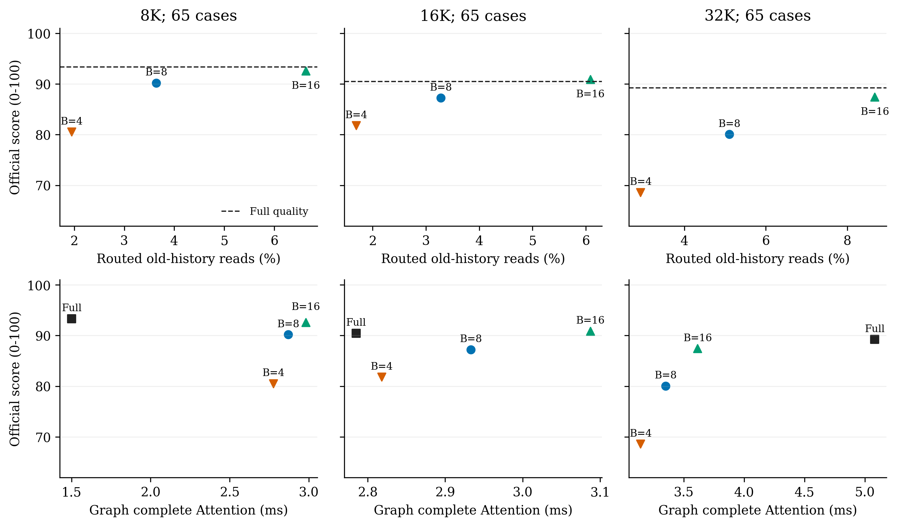

# Bucket-budget follow-up: 195 nonpilot RULER cases

This follow-up tests whether the 26-case pilot's budget trend holds on different
inputs. It retains Qwen3-8B, all 36 attention layers / 288 KV groups, the
3,000-feature SAE, assignments, moment ranking and indexed AV. The executed
worker is byte-identical to the pilot. Only the input cohort changes, including
the additional 16K length. Budgets remain B=4/8/16; no new tuning is performed.

The frozen sample rule selects five lexical-first nonpilot cases per task at
8K, 16K and 32K: 13 tasks x 3 lengths x 5 cases = 195. Canonical input-token
hashes show 195 distinct sequences and zero overlap with the pilot's 26 inputs.
This is a historical evaluation corpus. It is not a claim of independence from
every earlier development run, a new benchmark, or a complete train/test audit.

## Quality and actual reads

| Arm | Official score, all195 | Routed-only old reads, 194 eligible | Old reads including warmup, all195 | Outputs reaching cap |
| --- | ---: | ---: | ---: | ---: |
| Full Flash | 91.009 | 100%, dense | 100.000% | 1 |
| Top4 | 77.000 | 2.190% | 9.983% | 6 |
| Top8 | 85.838 | 4.014% | 11.580% | 4 |
| Top16 | 90.291 | 7.135% | 14.310% | 3 |

All 195 cases remain in quality, including one with no sparse forward and all
capped outputs. Read means follow each arm's own generation path. The common
first decode forward is dense. Generated tokens stay fully accessible and are
excluded from old-history ratios. A 0-15-token prompt remainder also stays
dense and is included in old reads. Quality uses official per-example scores,
not a binary exact-pass indicator.

Top8 loses 4.453 points to Top16 overall and 7.359 points at 32K. Thus the
near-equality on the initial 26 cases does **not** justify reducing the default
budget. Top16 loses 0.718 points to Full overall; this is a cohort mean, not
per-task equality or a quality guarantee. At 16K Top16 slightly exceeds Full,
which does not establish a general improvement.

## Latency on matching fixed replay/snapshots

| Length | Full Graph Attention | Top4 | Top8 | Top16 |
| --- | ---: | ---: | ---: | ---: |
| 8K, ms | 1.500 | 2.777 | 2.870 | 2.981 |
| 16K, ms | 2.785 | 2.818 | 2.933 | 3.087 |
| 32K, ms | 5.083 | 3.141 | 3.349 | 3.614 |

Graph measurements cover the complete Attention module, including routing,
bitmap union and indexed AV, on the same Full Q/K/V snapshots. Four repeats
per case are reduced to a median, then medians across 65 cases at each length.
Graphs are reusable; capture costs are saved separately. This is not a
whole-model Graph decoding measurement.

At 32K, the median paired module speedups are 1.611x/1.513x/1.400x for
Top4/8/16. All sparse paths are slower than Full at 8K and slightly slower at
16K. The separate 16-step eager model replay does not show acceleration:
at32K Full/Top4/Top8/Top16 take20.315/21.054/21.073/20.653ms per step.

As in the pilot, Top4/8 retain the native Top16 computation, then mask its
later ranks before the unchanged union. Both extra mask cost and unused work
are charged. These are not optimized specialized small-budget kernels.
See the [pilot's selector description](../bucket_budget/README.md).

Each column contains 65 quality cases. Top-row X is the routed-only old-read
mean (65/64/65 eligible cases by length); the dashed line gives Full quality.
Bottom-row X is complete-module Graph timing on common snapshots. The Y axis
is official free-generation quality. Both phases use the same fixed input
cohort; snapshots and own-path quality are not identical computations. All
measured points are shown, without an interpolated Pareto frontier.

## Checks and uncertainty

All 195 result closures and source pins pass, with 780 independent official
score replays, 168,480 literal-union/AV checks and 780 Graph/eager checks.
Maximum AV relative L2 error is 0.003049; Graph/eager outputs have zero measured
difference and selected IDs/counts agree. CPU reaggregation matches the saved
means and latency medians. The paired input-token hash audit also passes.

A descriptive paired bootstrap resamples the five cases within each of the
39 task-length cells (10,000 draws, seed20261107). The 95% percentile interval
for Top8 minus Top16 is[-6.932,-2.060] points; Top16 minus Full is
[-2.034,0.633]. These describe finite historical-cohort variability, not a
global independence, noninferiority or population-significance claim. Heads
and timing repeats are not treated as independent examples.

- [Full per-case results and repeated timings](summary.json).
- [Length and overall table](table.md).
- [Every task-length score/read cell](task_length.csv).
- [Input selection protocol](protocol.md), [input-token disjointness](input_disjoint_audit.json).
- [Aggregation, numerical and bootstrap audit](audit.json), [interval script](bootstrap.py).
- [PDF](budget_quality_latency.pdf), [SVG](budget_quality_latency.svg), [plot script](plot.py).

The plot received author-side visual inspection, not a new independent review.
This single-request PPU study does not measure NVIDIA, batching or throughput.
Dictionary size, key sparsity and update interval are fixed; their complete
sensitivity cannot be inferred from these three budget points.
