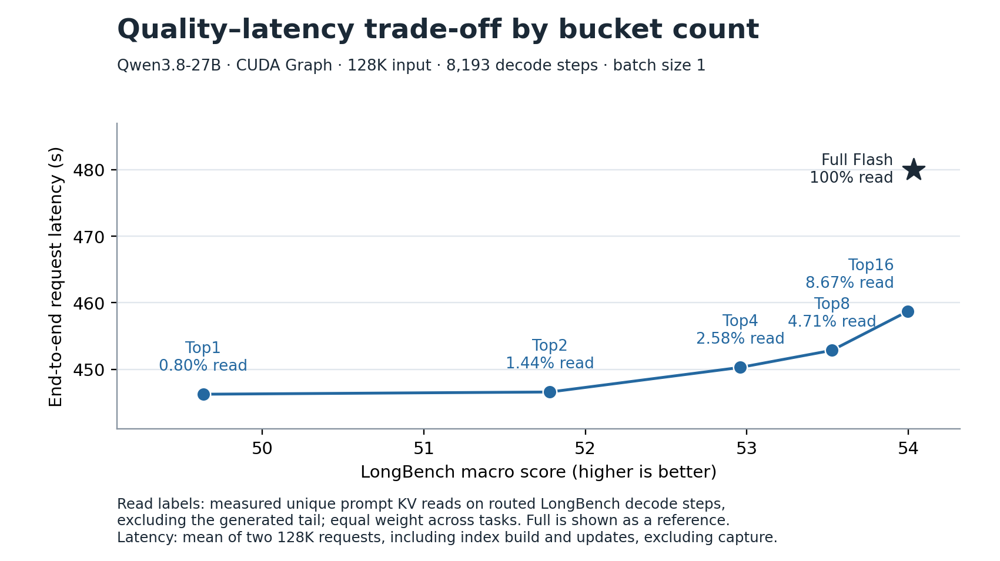

# 27B quality and request latency by bucket count

[Vector PDF](cuda_graph_bucket_count_pareto.pdf) · [SVG](cuda_graph_bucket_count_pareto.svg) · [Plotted points CSV](points.csv)

Quality is the macro average of 16 LongBench tasks across 3,750 examples per
configuration. Read percentages average each task equally and count unique
prompt KV positions on routed LongBench decode steps. The generated tail is
excluded from those percentages. See the [LongBench ablations](../longbench27b_ablations/README.md)
for scores by task and category.

Latency comes from a separate batch-1 experiment with Qwen3.8-27B on
PPU-ZW810. Full Flash and PrismKV both use Graph replay for decode. Each
point averages two runs with the same 131,072-token input and 8,193 decode
steps after prefill emits the first token. Decoding continues to the fixed
length after EOS. Reported request latency includes prefill, decode, the
initial index build and the two incremental updates for PrismKV. It excludes
Graph capture. Both repetitions of a configuration use the same card. Top4
and Top8 use different cards from Full.

| Configuration | LongBench score | LongBench prompt reads | 128K request latency (s) |
|---|---:|---:|---:|
| Full Flash | 54.034 | 100% | 480.00 |
| Top1 | 49.633 | 0.80% | 446.24 |
| Top2 | 51.781 | 1.44% | 446.58 |
| Top4 | 52.959 | 2.58% | 450.28 |
| Top8 | 53.527 | 4.71% | 452.84 |
| Top16 | 53.996 | 8.67% | 458.70 |
